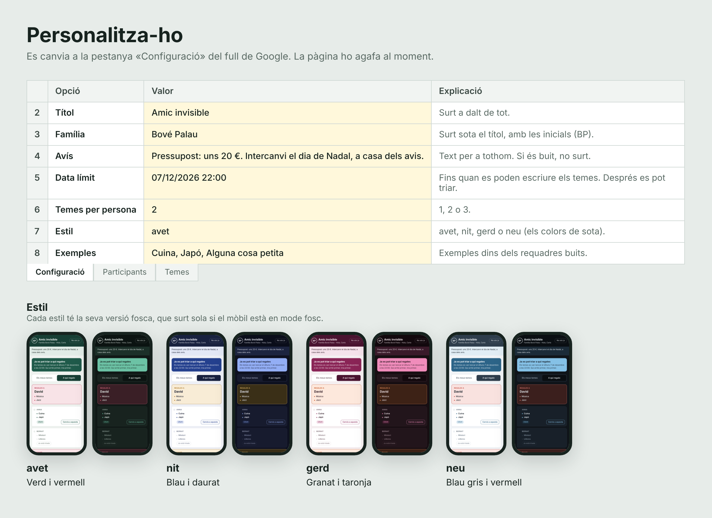

# Amic invisible: tauler de temes de regal

Un tauler on cada persona de la família escriu **2 temes de regal**, els que vulgui (p. ex. «Cuina» i «Japó»). Després, cadascú llegeix els temes dels altres i **tria una persona: serà a qui regala**. Com interpreta els temes, ho decideix qui regala. Ningú sap qui l'ha triat.

Funciona en dues fases, perquè tothom jugui amb les mateixes opcions:

1. **Fins a la data límit, s'escriuen els temes.** Cadascú pot escriure i canviar els seus. Dels altres només es veu si ja els han escrit, no quins són. Encara no es pot triar.
2. **Passada la data límit, es tria.** Els temes queden tancats i tothom els veu alhora. Qui arribi primer, tria primer. Qui no hagi posat temes també es pot triar: li faran una sorpresa total.

- **Tu no saps si algú t'ha triat, ni qui.** El servidor ni tan sols envia aquesta informació al teu mòbil.
- Els altres només veuen «Ja està triada», mai qui l'ha triada. Cada persona només la pot triar algú.
- **Cadascú tria una sola persona.** Qui tria veu «Regales a …» amb els seus temes, i pot desfer-ho o canviar-ho mentre quedin persones lliures.
- El tauler evita que l'última persona es quedi sense ningú a qui regalar.


## Accés: un enllaç per persona

No cal crear cap compte ni instal·lar res. Cada persona rep **el seu enllaç personal** (per WhatsApp, per exemple) i, en obrir-lo, ja hi és dins. El mòbil se'n recorda per a la propera vegada.

L'enllaç porta un codi de 6 lletres (`…/exec?codi=K7MPQ2`). Si algú el perd, pot obrir l'enllaç general i escriure-hi el codi.

> Cadascú ha de rebre només el seu enllaç: qui tingui l'enllaç d'una altra persona podria veure a qui regala.

## Com enviar-ho per WhatsApp

**1. Al grup de la família: les instruccions.**
Obre l'enllaç general de l'aplicació afegint-hi `?instruccions` al final (`…/exec?instruccions`). Hi surt una targeta amb el cargol, els passos i la data límit, i el text per al grup, amb un botó per copiar-lo. Fes una captura de pantalla de la targeta i envia-la al grup amb el text. Com que la targeta surt de la pestanya Configuració, sempre porta la data i els temes que hi tinguis posats.


**2. A cada persona, per privat: el seu enllaç.**
A la pestanya **Participants**, la columna **Envia-li per WhatsApp** té un enllaç per a cadascú. En prémer-lo, s'obre el WhatsApp amb el missatge ja escrit, amb el seu nom, el seu enllaç i la data límit:

> Hola, Anna! 🐌🎁
>
> Aquest és el teu enllaç per a l'amic invisible de la família Bové Palau:
> https://script.google.com/macros/s/…/exec?codi=K7MPQ2
>
> És només teu: no el passis a ningú, que t'hi podrien fer trampes.
>
> Tens fins al dilluns 7 de desembre a les 22:00 per posar els teus 2 temes. Després podràs triar a qui regales.

Si escrius el **telèfon** de cada persona a la columna D (p. ex. `600 11 22 33`), el missatge s'obre directament al seu xat. Si no, WhatsApp et deixa triar el contacte.

## Cost: 0 €

Tot funciona amb un full de Google Sheets i Apps Script, amb el teu compte de Google.

## Com posar-lo en marxa (uns 5 minuts)

1. Crea un full de càlcul nou a [Google Sheets](https://sheets.new) (p. ex. «Amic invisible Bové Palau»).
2. Menú **Extensions > Apps Script**. Esborra el que hi hagi a `Code.gs` i enganxa-hi [`Code.gs`](Code.gs).
3. Al costat de «Fitxers», prem **+ > HTML**, posa-li de nom `Index` (sense `.html`) i enganxa-hi [`Index.html`](Index.html). Desa (💾).
4. **Implementa > Nova implementació >** ⚙️ **Aplicació web**
   - Executa com a: **Jo**
   - Qui hi té accés: **Qualsevol**
   - Prem **Implementa** i accepta els permisos (si surt «Google no ha verificat aquesta aplicació», prem *Configuració avançada > Ves a … (no segur)*: l'aplicació és teva).
5. A l'editor, tria la funció **`prepara`** i prem **Executa**. Al full hi apareixen les pestanyes **Configuració**, **Participants** i **Temes**.
6. A **Configuració**, posa la **data límit** i repassa la resta (vegeu més avall).
7. A **Participants**, escriu els noms de la família a la columna A (n'hi ha uns de mostra: canvia'ls) i, si vols, els telèfons a la columna D.
8. Torna a carregar el full. Al menú **Amic invisible**, prem **Genera codis i enllaços**. Surt l'enllaç de cadascú i el botó per enviar-li per WhatsApp (vegeu a dalt).

## Personalitza-ho

Tot es canvia a la pestanya **Configuració** del full, i la pàgina ho agafa al moment: no cal tocar el codi ni tornar a implementar res.



| Opció | Per defecte | Què fa |
|---|---|---|
| Títol | Amic invisible | Surt a dalt de tot. |
| Família | Bové Palau | Surt sota el títol, amb les inicials (BP) en un cercle. Si és buit, hi surt un paquet de regal. |
| Avís | Pressupost: uns 20 €… | Text per a tothom: pressupost, data de l'intercanvi, lloc… Si és buit, no surt. |
| Data límit | 07/12/2026 22:00 | Fins quan es poden escriure i canviar els temes (dia/mes/any hora:minuts). Després s'obre la tria. Si és buit, es pot triar des del principi. |
| Temes per persona | 2 | 1, 2 o 3. |
| Estil | avet | Colors: **avet** (verd i vermell), **nit** (blau i daurat), **gerd** (granat i taronja) o **neu** (blau gris i vermell). Cadascun té versió fosca, que surt sola si el mòbil està en mode fosc. |
| Exemples | Cuina, Japó, Alguna cosa petita | Exemples dins dels requadres buits, separats per comes. |

### Si hi participes tu també

Tu tens accés al full, però pots jugar igual sense fer trampes sense voler:

- Qui ha triat cada persona es desa a la pestanya **Tries**, que està **amagada**. No la mostris.
- Fins i tot allà, qui ha triat es desa xifrat (no hi surt cap nom), i els temes s'identifiquen amb un codi, no amb el text.

### Canvis més endavant

- **Canviar noms o afegir-ne:** canvia'ls a la pestanya Participants i prem **Amic invisible > Genera codis i enllaços**. Qui ja hi era conserva el seu codi i el seu enllaç.
- **Actualitzar el codi (si en fem una versió nova):** enganxa el codi nou, desa, i ves a **Implementa > Gestiona les implementacions > ✏️ > Versió: Versió nova > Implementa**. L'enllaç no canvia.
- **Si algú ha perdut el codi:** el tens a la pestanya Participants.
- **Si canvies la data límit:** torna a prémer **Genera codis i enllaços** perquè els missatges de WhatsApp portin la data nova. La pàgina i la targeta d'instruccions ja l'agafen soles.

## Proves

```
node tests/amic-invisible.mjs
```

Executa el `Code.gs` real amb un Google Sheets simulat i obre la pàgina a Chromium amb tres persones. Comprova la personalització, les dues fases (abans i després de la data límit), el missatge de WhatsApp i la targeta d'instruccions i, a més, entrar amb l'enllaç o amb el codi, escriure i canviar els 2 temes, triar, que la persona triada no en sàpiga res, que no es pugui triar dues vegades, canviar i desfer la tria, i que l'última persona no es quedi sense ningú a qui regalar.
