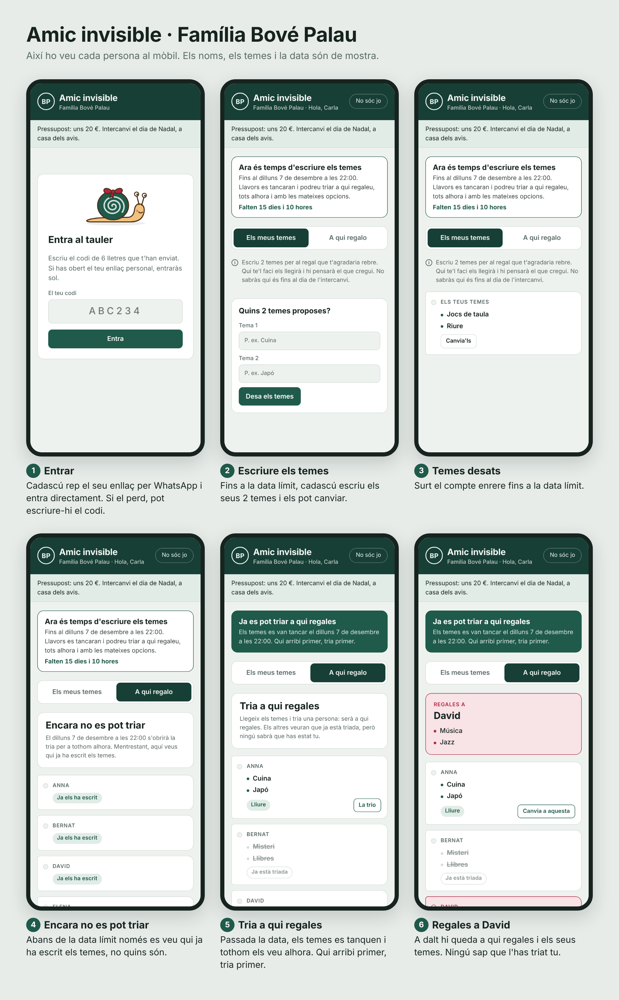
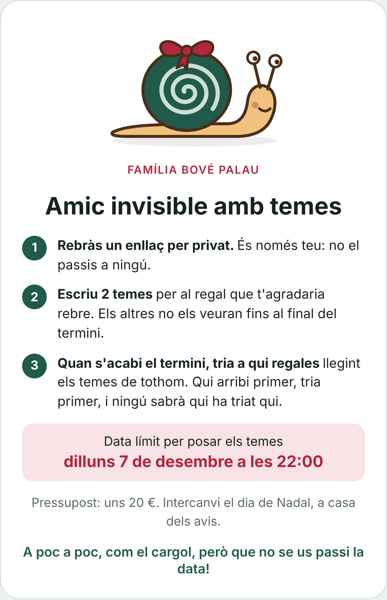

# Amic invisible: tauler de temes de regal

Un tauler on cada persona de la família escriu **2 temes de regal**, els que vulgui (p. ex. «Cuina» i «Japó»). Després, cadascú llegeix els temes dels altres i **tria una persona: serà a qui regala**. Com interpreta els temes, ho decideix qui regala. Ningú sap qui l'ha triat.

Funciona en dues fases, perquè tothom jugui amb les mateixes opcions:

1. **Fins a la data límit, s'escriuen els temes.** Cadascú pot escriure i canviar els seus. Dels altres només es veu si ja els han escrit, no quins són. Encara no es pot triar.
2. **Passada la data límit, es tria.** Els temes queden tancats i tothom els veu alhora. Qui arribi primer, tria primer. Qui no hagi posat temes també es pot triar: li faran una sorpresa total.

- **Tu no saps si algú t'ha triat, ni qui.** El servidor ni tan sols envia aquesta informació al teu mòbil.
- Els altres només veuen «Ja està triada», mai qui l'ha triada. Cada persona només la pot triar algú.
- **Cadascú tria una sola persona.** Qui tria veu «Regales a …» amb els seus temes, i pot desfer-ho o canviar-ho mentre quedin persones lliures.
- El tauler evita que l'última persona es quedi sense ningú a qui regalar.



## On s'obre la pàgina

La pàgina per a la família es publica a **GitHub Pages**, al mateix lloc que la Xiu-xiu: `https://oriol-cmd.github.io/projectes-Oriol/amic-invisible-bove-palau/`. El full de Google continua guardant-ho tot, però la pàgina hi parla sense fer servir cap compte de Google. Així s'obre bé en qualsevol mòbil, també si hi ha diversos comptes de Google oberts. (Si s'obre directament des de Google, aquests mòbils donen l'error «No s'ha pogut obrir el fitxer en aquest moment».)

Els enllaços personals són curts, del tipus `https://oriol-cmd.github.io/projectes-Oriol/amic-invisible-bove-palau/?codi=K7MPQ2`, i els genera el full sol. Funcionen perquè la pàgina publicada ja porta l'identificador de l'aplicació de Google, que és a [`app-id.txt`](app-id.txt). Si mai fas una implementació **nova** (no una versió nova), l'identificador canvia: posa el nou a `app-id.txt`.

Si a Configuració l'«Adreça de la pàgina» és buida, els enllaços van directament a Google.

El primer cop que algú obre el seu enllaç, li surt un full amb el cargol que explica com funciona, i l'ha d'acceptar amb **«Entesos, som-hi!»**. Després el pot tornar a consultar amb el botó **«Com funciona?»**, a baix de tot.

## Accés: un enllaç per persona

No cal crear cap compte ni instal·lar res. Cada persona rep **el seu enllaç personal** (per WhatsApp, per exemple) i, en obrir-lo, ja hi és dins. El mòbil se'n recorda per a la propera vegada.

L'enllaç porta un codi de 6 lletres (`…/exec?codi=K7MPQ2`). Si algú el perd, pot obrir l'enllaç general i escriure-hi el codi.

> Cadascú ha de rebre només el seu enllaç: qui tingui l'enllaç d'una altra persona podria veure a qui regala.

## Com enviar-ho per WhatsApp

**1. Al grup de la família: les instruccions.**
Obre l'enllaç general de l'aplicació afegint-hi `?instruccions` al final (`…/exec?instruccions`). Hi surt una targeta amb el cargol, els passos i la data límit, i el text per al grup, amb un botó per copiar-lo. Fes una captura de pantalla de la targeta i envia-la al grup amb el text. Com que la targeta surt de la pestanya Configuració, sempre porta la data i els temes que hi tinguis posats.



**2. A cada persona, per privat: el seu enllaç.**
A la pestanya **Participants**, la columna **Envia-li per WhatsApp** té un enllaç per a cadascú. En prémer-lo, s'obre el WhatsApp amb el missatge ja escrit, amb el seu nom, el seu enllaç i la data límit:

> Hola, Anna! 🐌🎁
>
> Aquest és el teu enllaç per a l'amic invisible de la família Bové Palau:
> https://script.google.com/macros/s/…/exec?codi=K7MPQ2
>
> És només teu: no el passis a ningú, que t'hi podrien fer trampes.
>
> Tens fins al dilluns 7 de desembre a les 22:00 per posar els teus 2 temes. Després podràs triar a qui regales.

Si escrius el **telèfon** de cada persona a la columna D (p. ex. `600 11 22 33`), el missatge s'obre directament al seu xat. Si no, WhatsApp et deixa triar el contacte.

## Cost: 0 €

Tot funciona amb un full de Google Sheets i Apps Script, amb el teu compte de Google.

## Com posar-lo en marxa (uns 15 minuts)

Fes-ho des d'un ordinador. Millor amb un **compte de Google personal** (Gmail): els comptes d'empresa sovint no deixen obrir l'aplicació a gent de fora.

**1. Crea el full**
1. Ves a [sheets.new](https://sheets.new) i posa-li de nom «Amic invisible Bové Palau».

**2. Enganxa el codi**
1. Al full: menú **Extensions > Apps Script**. S'obre l'editor en una pestanya nova.
2. A dalt a l'esquerra, canvia «Projecte sense títol» per «Amic invisible».
3. A la llista de fitxers hi ha `Codi.gs` (o `Code.gs`). Obre'l, esborra tot el que hi ha i enganxa-hi el contingut de [`Code.gs`](Code.gs).
4. Al costat de «Fitxers», prem **+ > HTML**. Posa-li de nom `Index` (exactament així, sense `.html`), esborra el que hi hagi i enganxa-hi [`Index.html`](Index.html).
5. Prem **Desa** (💾).
6. A l'esquerra, ⚙️ **Configuració del projecte > Zona horària**: tria *(GMT+01:00) Hora d'Europa central – Madrid*. Així la data límit és l'hora d'aquí.

**3. Publica l'aplicació**
1. A dalt a la dreta: **Implementa > Nova implementació**.
2. A «Selecciona el tipus», prem ⚙️ i tria **Aplicació web**.
3. Descripció: «Amic invisible». **Executa com a: Jo**. **Qui hi té accés: Qualsevol**.
4. Prem **Implementa**. Google et demana permisos: **Autoritza l'accés**, tria el teu compte i, si surt «Google no ha verificat aquesta aplicació», prem **Configuració avançada > Ves a Amic invisible (no segur)** i **Permet**. És segur: l'aplicació és teva.
5. Copia l'**URL de l'aplicació web** (acaba en `/exec`). La necessitaràs al pas 5.

**4. Crea les pestanyes**
1. A l'editor, a dalt, al desplegable de funcions, tria **`prepara`** i prem **Executa**.
2. Al full hi apareixen les pestanyes **Configuració**, **Participants** i **Temes**.

**5. Omple la configuració** (pestanya **Configuració**, columna Valor)
- **Enllaç de l'aplicació:** enganxa-hi l'URL del pas 3, la que acaba en `/exec`.
- **Data límit:** fins quan es poden escriure els temes, p. ex. `07/12/2026 22:00`.
- **Avís:** pressupost i dia de l'intercanvi.
- La resta, si vols: títol, família, temes per persona, estil i exemples (vegeu [Personalitza-ho](#personalitza-ho)).

**6. Escriu la família** (pestanya **Participants**)
- Columna A: els noms (n'hi ha uns de mostra: esborra'ls o canvia'ls). Cada nom ha de ser diferent.
- Columna D (opcional): el mòbil de cadascú, p. ex. `600 11 22 33`.
- Columna F, **Pot configurar**: escriu **Sí** a la teva fila. Així veuràs la pestanya **Ajustos** a l'aplicació. (Si encara no hi és, surt en prémer el pas 7.)

**7. Genera els enllaços**
1. Torna a carregar el full (F5). Al cap d'uns segons, a dalt surt el menú **Amic invisible**.
2. **Amic invisible > Genera codis i enllaços**. A Participants surt el codi, l'enllaç personal i el botó **Envia-li ➜** de cadascú.

**8. Prova-ho tu primer**
1. Obre el teu enllaç personal (columna C, la teva fila): hi has d'entrar directament i veure «Hola, …».
2. Escriu-hi els teus temes. A la pestanya Temes del full hi apareixen.
3. Obre l'enllaç general acabat en `?instruccions`: hi ha de sortir la targeta del cargol.
4. Prem un botó **Envia-li ➜**: s'ha d'obrir el WhatsApp amb el missatge escrit (no cal enviar-lo).

**9. Envia-ho** (vegeu [Com enviar-ho per WhatsApp](#com-enviar-ho-per-whatsapp))
1. Al grup: la captura de la targeta i el text.
2. A cadascú, per privat: el seu missatge amb el botó **Envia-li ➜**.

### Si alguna cosa no va
- **«No s'ha pogut obrir el fitxer en aquest moment»:** l'enllaç va directament a Google i el mòbil té més d'un compte de Google obert. Comprova que a Configuració l'«Adreça de la pàgina» és `https://oriol-cmd.github.io/projectes-Oriol/amic-invisible-bove-palau/` i torna a prémer **Genera codis i enllaços**: els enllaços passaran a anar a GitHub.
- **«No s'ha trobat el fitxer HTML Index»:** el fitxer HTML no es diu exactament `Index`.
- **La família no hi pot entrar o els demana iniciar sessió:** a la implementació, «Qui hi té accés» ha de ser **Qualsevol**. Si no surt aquesta opció, és un compte d'empresa: fes-ho amb un Gmail personal.
- **Els enllaços acaben en `/dev`:** aquests només funcionen per a tu. Enganxa a Configuració l'URL que acaba en `/exec`.
- **No surt el menú «Amic invisible»:** torna a carregar el full i espera uns segons. També pots executar `prepara` des de l'editor: fa el mateix.
- **Has canviat el codi:** **Implementa > Gestiona les implementacions > ✏️ > Versió: Versió nova > Implementa**. L'enllaç no canvia.

## Ajustos: tot des del mòbil

Qui tingui **Sí** a la columna «Pot configurar» de Participants veu una tercera pestanya, **Ajustos**, a l'aplicació. Des d'allà, sense obrir el full:

- **Data límit:** dia i hora. Quan la canvies, els missatges de WhatsApp ja porten la data nova.
- **Textos:** títol, família i avís (dia de l'intercanvi, lloc…).
- **Pressupost:** sense límit, o una quantitat màxima en euros.
- **Joc:** temes per persona, colors i exemples.
- **Família:** per a cada persona, el botó **WhatsApp** (obre el xat amb el missatge i el seu enllaç), **Copia l'enllaç**, el **mòbil** (opcional, només perquè el WhatsApp s'obri directament al seu xat), **Treu** i la casella **Ajustos** per donar-li o treure-li l'accés. A sota, **Persona nova**: nom i, si vols, mòbil.
- **Instruccions per al grup:** obre la targeta del cargol.
- **Edició nova (l'any que ve):** vegeu més avall.

Als Ajustos no hi surt mai qui ha triat qui. Però qui hi té accés pot veure els enllaços de tothom: dona'l només a qui organitzi.

## L'any que ve

1. Entra a **Ajustos > Edició nova**, posa la nova data límit i prem **Comença l'edició nova** (dues vegades, per confirmar).
2. Els temes d'aquest any queden guardats en una pestanya **Arxiu 2026** del full, i el tauler queda net.
3. La família i els enllaços són els mateixos: només cal tornar a enviar les instruccions al grup. Si arriba algú nou, afegeix-lo a **Família** i envia-li el seu enllaç.

## Personalitza-ho

Tot es canvia a la pestanya **Configuració** del full, i la pàgina ho agafa al moment: no cal tocar el codi ni tornar a implementar res.


Tot això també es pot canviar des de la pestanya **Ajustos** de l'aplicació.

| Opció | Per defecte | Què fa |
|---|---|---|
| Enllaç de l'aplicació | (buit) | L'URL que acaba en `/exec`. Amb ella es fan els enllaços personals. |
| Títol | Amic invisible | Surt a dalt de tot. |
| Família | Bové Palau | Surt sota el títol, amb les inicials (BP) en un cercle. Si és buit, hi surt un paquet de regal. |
| Avís | Intercanvi el dia de Nadal… | Text per a tothom: data de l'intercanvi, lloc… Si és buit, no surt. |
| Pressupost màxim | (buit) | Quants euros com a màxim. Si és buit, no hi ha límit i no surt enlloc. Als Ajustos: casella «Hi ha un pressupost màxim» i la quantitat. |
| Data límit | 07/12/2026 22:00 | Fins quan es poden escriure i canviar els temes (dia/mes/any hora:minuts). Després s'obre la tria. Si és buit, es pot triar des del principi. |
| Temes per persona | 2 | 1, 2 o 3. |
| Estil | avet | Colors: **avet** (verd i vermell), **nit** (blau i daurat), **gerd** (granat i taronja) o **neu** (blau gris i vermell). Cadascun té versió fosca, que surt sola si el mòbil està en mode fosc. |
| Exemples | Cuina, Japó, Alguna cosa petita | Exemples dins dels requadres buits, separats per comes. |

### Si hi participes tu també

Tu tens accés al full, però pots jugar igual sense fer trampes sense voler:

- Qui ha triat cada persona es desa a la pestanya **Tries**, que està **amagada**. No la mostris.
- Fins i tot allà, qui ha triat es desa xifrat (no hi surt cap nom), i els temes s'identifiquen amb un codi, no amb el text.

### Canvis més endavant

- **Canviar noms o afegir-ne:** canvia'ls a la pestanya Participants i prem **Amic invisible > Genera codis i enllaços**. Qui ja hi era conserva el seu codi i el seu enllaç.
- **Actualitzar el codi (si en fem una versió nova):** enganxa el codi nou, desa, i ves a **Implementa > Gestiona les implementacions > ✏️ > Versió: Versió nova > Implementa**. L'enllaç no canvia.
- **Si algú ha perdut el codi:** el tens a la pestanya Participants.
- **Si canvies la data límit:** torna a prémer **Genera codis i enllaços** perquè els missatges de WhatsApp portin la data nova. La pàgina i la targeta d'instruccions ja l'agafen soles.

## Proves

```
node tests/amic-invisible.mjs
```

Executa el `Code.gs` real amb un Google Sheets simulat i obre la pàgina a Chromium amb tres persones. Comprova la personalització, les dues fases (abans i després de la data límit), el missatge de WhatsApp i la targeta d'instruccions i, a més, entrar amb l'enllaç o amb el codi, escriure i canviar els 2 temes, triar, que la persona triada no en sàpiga res, que no es pugui triar dues vegades, canviar i desfer la tria, i que l'última persona no es quedi sense ningú a qui regalar.
